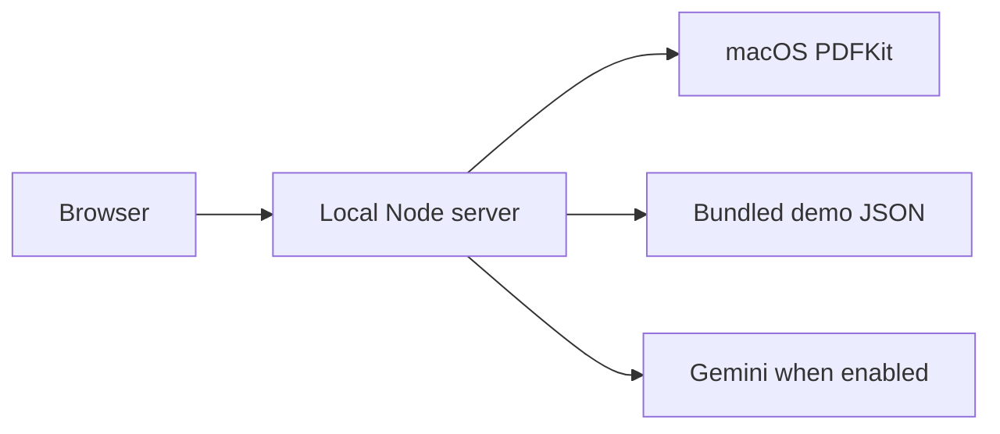

# Architecture Spine — AI Study Buddy

## Design Paradigm

A layered client-server application. The browser owns interaction and study state. The local Node server coordinates PDF processing, bundled demo resources, and optional Gemini generation.

## Invariants & Rules

### AD-1 — Browser-owned study session [ADOPTED]

- **Binds:** FR-1, FR-4–FR-9.
- **Prevents:** Resources or answers from different study sessions being mixed or restored.
- **Rule:** Keep the active PDF, study resources, and answers in browser memory. Use no database or persistent study history. Remove temporary server files when each request completes.

### AD-2 — Local PDF processing and optional generation [ADOPTED]

- **Binds:** FR-2, FR-3, FR-12–FR-14.
- **Prevents:** Sending full PDF files to Gemini or making demo usage depend on provider access.
- **Rule:** Extract text and render pages locally with PDFKit. Serve the keyless demo from bundled JSON. With Gemini enabled, send text and page metadata from usable pages. Keep the API key on the server.

### AD-3 — Source references use physical PDF pages [ADOPTED]

- **Binds:** FR-5–FR-8, FR-10, FR-11.
- **Prevents:** Showing the wrong page or presenting a failed excerpt check as verified.
- **Rule:** Number pages from 1 in PDF order. Compare Gemini excerpts against the text on the cited page after normalising case and whitespace. Display failed excerpt matches as **Ubekreftet**. Return only the requested page image to the source panel.

## Consistency Conventions

| Concern | Convention |
| --- | --- |
| Language | English project documentation and Norwegian student-facing copy. Preserve relevant Latin anatomy terms. |
| Interfaces | `POST /pdf` returns page data and available study resources. `POST /pdf-page/<page-number>` returns a PNG. |
| Local operation | Bind the HTTP server to loopback. Read optional Gemini configuration from the server environment. |

## Stack

| Name | Version |
| --- | --- |
| Node.js | 24 |
| macOS PDFKit | System framework |
| HTML, CSS, JavaScript | Browser-native |
| npm dependencies | None |

## Capability → Architecture Map

| Capability | Lives in | Governed by |
| --- | --- | --- |
| Study session and practice | [`index.html`](../../../app/index.html) | AD-1 |
| PDF extraction and page rendering | [`server.mjs`](../../../app/server.mjs), [`les-pdf.js`](../../../app/les-pdf.js), [`grupper.js`](../../../app/grupper.js), [`render-pdf-side.js`](../../../app/render-pdf-side.js) | AD-2, AD-3 |
| Demo resources and optional live generation | [`demo-ressurser.json`](../../../app/demo-ressurser.json), [`gemini-summary.mjs`](../../../app/gemini-summary.mjs) | AD-2, AD-3 |

## Deferred

- The current application lacks the FR-3 confirmation step for PDFs with insufficient text on some pages.
- FR-12 request counting and the PRD spending ceiling still need implementation. Confirm the Gemini service tier for student material and validate live generation with a representative PDF at the supported limits.
- The [submission test](../../../app/TESTLOGG.md) covers the keyless demo.
