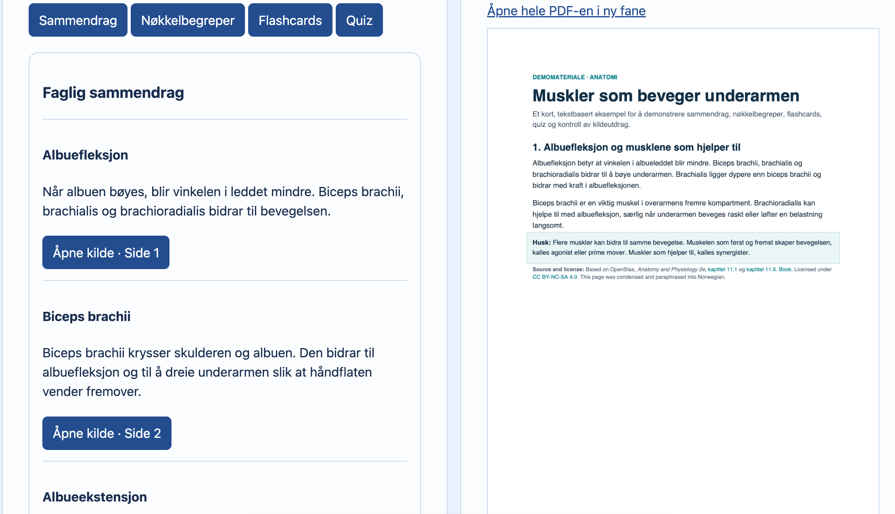

# Designvalg for AI Study Buddy

Vi valgte **Side ved side**, en av de fire lyseblå variantene i den senere Kildespor-runden. Studenten kan lese en studieressurs og åpne den siterte PDF-siden i samme arbeidsflate. Det gjør det lettere å kontrollere kildeutdrag og sammenligne informasjon som er fordelt på flere kolonner i originalen.

[Se «Side ved side» i den blå konseptrunden](concepts/kildespor-fire-bla-varianter.svg#konsept-2). De fire [tidlige konseptene](concepts/README.md) viser utforskingen som kom før denne runden. [UX-beskrivelsen](EXPERIENCE.md), [skjermskissen](screen-sketch.md) og [designbeskrivelsen](DESIGN.md) dokumenterer arbeidet med den tidlige prototypen. Designbeskrivelsens teal-palett tilhører den fasen. Den kjørbare appen bruker den senere lyseblå retningen.

## Fra design til app

| Behov | Løsning i den kjørbare appen |
| --- | --- |
| Sjekke et faglig poeng mot PDF-en | En kildeknapp åpner et bilde av den valgte siden i kildepanelet. Hele dokumentet kan åpnes i en egen fane. |
| Lese på ulike skjermstørrelser | Appen viser studieressurs og kilde ved siden av hverandre på bred skjerm, og plasserer kildepanelet under ressursene på smal skjerm. |
| Øve på fagstoffet | Flashcards viser svaret og kilden etter **Vis svar**. Quiz viser fasit og kilder etter levering. |
| Forstå quizresultatet | Fasiten bruker både tekst og farge for å vise riktige, feil og ubesvarte spørsmål. Omforsøk stokker spørsmålene. Full pott i første runde åpner et nytt sett. |

Ved innleveringstesten åpnet nettleseren først hele PDF-en fra en sidelenke. Etter rettelsen bekreftet brukeren at kildepanelet viste bare side 3. Testloggen for commit `b870e9f` dekker også flashcards og quiz. Oppsettet for smale skjermer er implementert i CSS. Den avgrensede testen av smal visning og tastatur er dokumentert nedenfor.

## Skjermbredde og tastatur

Kodegjennomgangen bekrefter to kolonner som standard og én kolonne ved vindusbredde opptil 48 rem. Kildeknappene er vanlige HTML-knapper med synlig fokusmarkering. På smal skjerm flyttes fokus til overskriften «PDF-visning» når kilden åpnes.

For å dokumentere nettlesertesten med den medfølgende demo-PDF-en:

1. Åpne **Sammendrag → Åpne kilde · Side 1** i et bredt vindu. Ta et skjermbilde med sammendraget og PDF-siden synlige samtidig.
2. Gjenta i et smalt vindu, for eksempel 390 piksler bredt. Sjekk at PDF-panelet ligger under studieressursene, og ta et skjermbilde som viser rekkefølgen.
3. Bruk `Tab` til en kildeknapp. Sjekk at fokusmarkeringen er synlig, trykk `Enter` og kontroller at riktig PDF-side åpnes.

**Bred visning, 16. november 2026:** Brukerens skjermbilde viser «Albuefleksjon» i sammendraget til venstre og side 1 fra demo-PDF-en til høyre. Begge var synlige samtidig.

**Smal visning:** Brukerens skjermbilde viser PDF-panelet under sammendraget og en synlig fokusramme rundt «PDF-visning». Appen meldte at side 2 ikke kunne vises. Ved oppfølging svarte ikke den lokale serveren. Etter omstart returnerte serveren et bilde av side 2. Etter omstart bekreftet brukeren at side 2 åpnet seg med tastaturet i smal visning.

[Appkode](../../../../app/index.html) · [Testlogg](../../../../app/TESTLOGG.md) · [Rettelse av kildevisningen](https://github.com/IBE160-2026/G133-magnussen/pull/2)
