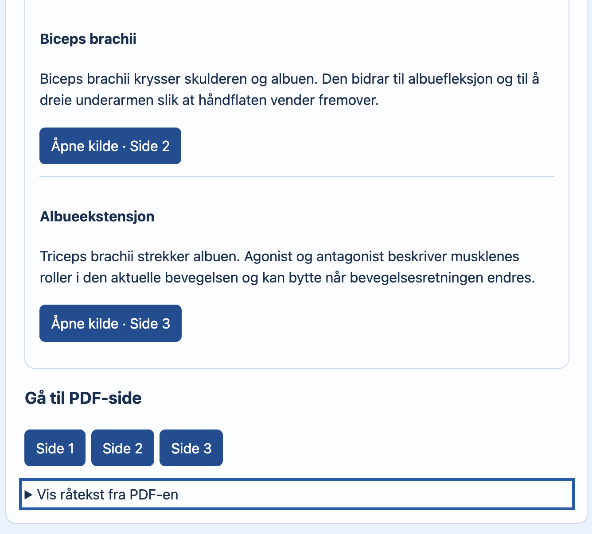
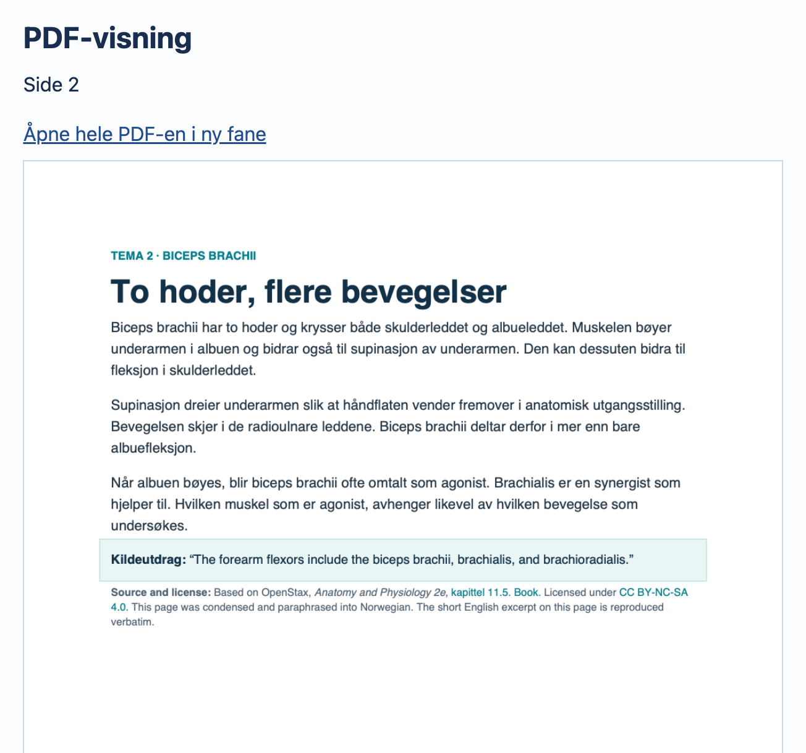

# AI Study Buddy design decision

We chose **Side by Side** (*Side ved side*), one of the four light blue variants in the later Kildespor round. Students can read a study resource and open the cited PDF page in the same view. This makes it easier to check excerpts and compare information spread across multiple columns in the original.

The [blue concept round](concepts/kildespor-fire-bla-varianter.svg#konsept-2) shows the selected design. The [four early concepts](concepts/README.md) show the exploration that preceded it. The [UX description](EXPERIENCE.md), [screen sketch](screen-sketch.md), and [design description](DESIGN.md) document the early prototype, which used a teal palette. The runnable application uses the later light blue direction.

## From design to implementation

| Student need | Behaviour in the runnable application |
| --- | --- |
| Check a claim against the PDF | A source button opens an image of the selected page in the source panel. The full document can be opened in a separate tab. |
| Read at different window widths | The application displays the study resource and source side by side in wide windows. In narrow windows, the source panel appears below the study resources. |
| Practise the material | Flashcards display the answer and source after **Vis svar** is selected. Quizzes display the answers and sources after submission. |
| Understand quiz results | Results use text and colour to distinguish correct, incorrect, and unanswered questions. Retries shuffle the questions. A perfect score in the first round unlocks a new set. |

During the submission test, a source link initially opened the whole PDF. After the fix, the user confirmed that the panel displayed only page 3. The test log for commit `b870e9f` also covers flashcards and quizzes. CSS handles the narrow layout. The narrower scope of the keyboard test is recorded below.

## Window width and keyboard interaction

The code uses two columns by default and one column up to a window width of 48 rem. Source buttons are standard HTML buttons with visible focus indicators. In narrow windows, focus moves to the **PDF-visning** heading when the source opens.

To record the browser test with the included demo PDF:

1. Open **Sammendrag → Åpne kilde · Side 1** in a wide window. Capture the summary and PDF page in the same screenshot.
2. Repeat in a narrow window, for example at 390 pixels wide. Check that the PDF panel sits below the study resources and capture that layout.
3. Use `Tab` to reach a source button. Check the focus indicator, press `Enter`, and confirm that the correct PDF page opens.

**Wide layout, 16 November 2026.** The user's screenshot shows the summary about elbow flexion on the left and page 1 of the demo PDF on the right, both visible at the same time.

**Narrow layout.** The user's screenshot shows the PDF panel below the summary and a visible focus outline around **PDF-visning**. Initially, the application reported that it could not display page 2. The local server did not respond during follow-up. After a restart, the server returned an image of page 2, and the user confirmed that it opened with the keyboard in the narrow layout.

The screenshots were taken in the same narrow window. The first shows the summary and its source button. The second shows page 2 open lower down on the same page.

[Application code](../../../../app/index.html) · [Test log](../../../../app/TESTLOGG.md) · [Source-viewing fix](https://github.com/IBE160-2026/G133-magnussen/pull/2)
