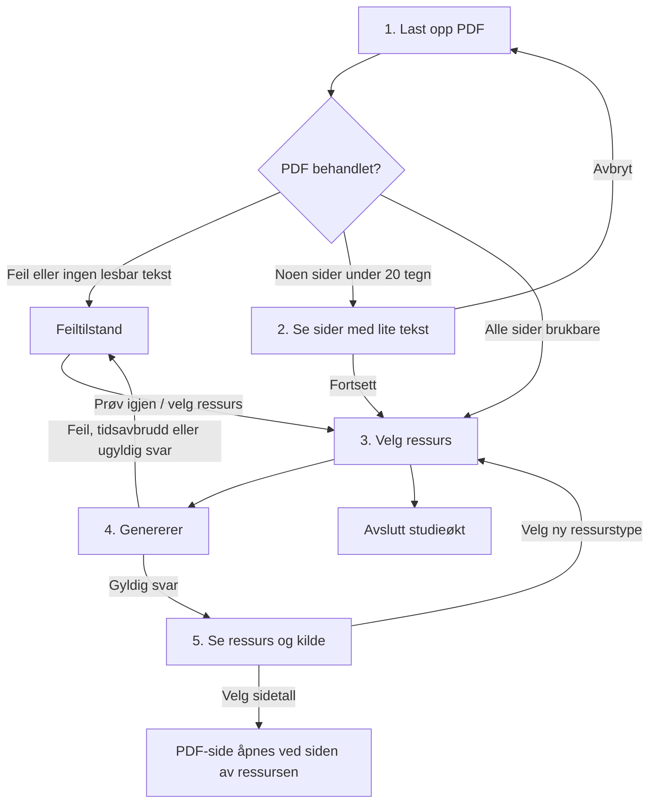

# AI Study Buddy — første skjermskisse

**Status:** UX-konsepter til gjennomgang
**Forankring:** PRD FR-1–FR-14
**Formål:** Avklare skjermrekkefølge, innhold og viktige tilstander før implementering.

**Klikkbar prototype:** [prototype.html](prototype.html). Den bruker lokale eksempeldata og simulerte provider-svar; den leser eller sender ikke PDF-filer.

**UX-dokumenter:** [DESIGN.md](DESIGN.md) beskriver den visuelle retningen; [EXPERIENCE.md](EXPERIENCE.md) beskriver oppførsel, tilstander og tilgjengelighet. Begge er utkast til gjennomgang.

Skissen beskriver oppførsel og hierarki. Den tidligere klikkbare prototypen bruker et første, rolig og moderne visuelt utkast og er kun arbeidsmateriale. De fire retningene i [concepts/](concepts/README.md) utforsker bredere uttrykk. På tidspunktet for denne skissen var ingen retning valgt eller godkjent. Paletten og komponentstilen i DESIGN.md er fortsatt et utkast. Test-mocks brukes i utvikling for å simulere vellykkede og ugyldige KI-svar; studenten ser vanlige resultater eller norske feilmeldinger. Demo-modus bruker lagrede eksempelresultater uten API-nøkkel.

## Brukerflyt



## Skjerm 1 — Last opp PDF

```text
┌──────────────────────────────────────────────────────────────┐
│ AI Study Buddy                                Studieøkt      │
├──────────────────────────────────────────────────────────────┤
│ Gjør kurs-PDF-en om til øvingsmateriell                      │
│                                                              │
│ ┌──────────────────────────────────────────────────────────┐ │
│ │ Slipp PDF-filen her                                      │ │
│ │ eller                                                    │ │
│ │ [ Velg PDF ]                                             │ │
│ └──────────────────────────────────────────────────────────┘ │
│ Maks. 20 MB og 50 sider.                                     │
│                                                              │
│ [Start demo med eksempel-PDF]                                │
└──────────────────────────────────────────────────────────────┘
```

- Filgrensefeil forklarer om filen er for stor eller har for mange sider. Filen behandles ikke.
- Under behandling vises en enkel ventetilstand. Generering er ikke tilgjengelig før PDF-en er behandlet.
- Demo-knappen starter den dokumenterte keyless demoen med eksempel-PDF og lagrede svar.

## Skjerm 2 — Sider med lite uttrekkbar tekst

Vises bare når én eller flere sider har færre enn 20 ikke-whitespace-tegn. Sidetall følger PDF-viseren, fra side 1.

```text
┌──────────────────────────────────────────────────────────────┐
│ Vi fant sider med lite lesbar tekst                          │
│                                                              │
│ Side 1 · Side 2 · Side 7 · Side 9                            │
│ Disse sidene tas ikke med hvis du fortsetter.                 │
│                                                              │
│ 46 av 50 sider har nok uttrekkbar tekst.                     │
│                                                              │
│ [Fortsett med 46 sider]                 [Avbryt]              │
└──────────────────────────────────────────────────────────────┘
```

- Brukeren får vite hvilke sider som utelates før KI-generering starter.
- «Fortsett» bruker bare sider som består uttrekksterskelen. «Avbryt» starter ingen generering.
- Hvis alle sider er brukbare, går appen direkte til ressursvalg. Hvis ingen sider er brukbare, vises en feil med forklaring og mulighet til å velge en annen PDF.

## Skjerm 3 — Velg ressurs

```text
┌──────────────────────────────────────────────────────────────┐
│ Studieøkt                               8 KI-forespørsler igjen│
│ Eksempel-PDF.pdf · 46 av 50 sider med i grunnlaget            │
├──────────────────────────────────────────────────────────────┤
│ Hva vil du øve på?                                           │
│                                                              │
│ [ Sammendrag ]          [ Nøkkelbegreper ]                   │
│ [ Flashcards ]          [ Quiz ]                             │
│                                                              │
│ Ressurser du allerede har laget                              │
│ • Ingen ennå                                                 │
│                                                              │
│                                             [Avslutt studieøkt]│
└──────────────────────────────────────────────────────────────┘
```

- Etter at en ressurs er laget, vises den i listen og kan åpnes igjen i samme studieøkt.
- Telleren gjelder live-modus. Forespørsler telles når de startes, også når de feiler. Demo-modus bruker ikke leverandørforespørsler.
- Ved null forespørsler igjen forklarer appen at grensen er nådd, og starter ikke en ny leverandørforespørsel.
- Ett PDF-dokument brukes gjennom hele studieøkten. For å bytte PDF avslutter studenten økten og starter en ny.

## Skjerm 4 — Generering og feil

```text
┌──────────────────────────────────────────────────────────────┐
│ Lager flashcards …                                           │
│                                                              │
│ Vi bruker den opplastede PDF-en. Dette kan ta litt tid.       │
└──────────────────────────────────────────────────────────────┘
```

Ved leverandørfeil, tidsavbrudd eller svar som ikke kan tolkes:

```text
┌──────────────────────────────────────────────────────────────┐
│ Vi kunne ikke lage ressursen                                 │
│ Prøv igjen eller velg en annen ressurs.                      │
│ Ingen delvis ressurs ble lagret.                              │
│                                                              │
│ 7 KI-forespørsler igjen.                                      │
│                                                              │
│ [Prøv igjen]                         [Tilbake til ressurser]  │
└──────────────────────────────────────────────────────────────┘
```

Feilteksten er et forslag til mikrocopy. Telleren går ned fordi forsøket telles når det startes. Ressurser som ble laget tidligere, forblir tilgjengelige i studieøkten.

## Skjerm 5 — Ressurs med kilde og PDF-viser

På bred skjerm står ressursen og PDF-viseren ved siden av hverandre. På smal skjerm stables de, og valgt PDF-side åpnes under ressursen.

```text
┌───────────────────────────────────────┬──────────────────────┐
│ Sammendrag · Muskelvev                │ PDF                  │
│                                       │                      │
│ • Muskelvev kan trekke seg sammen …   │ Side 12 av 50        │
│   Kilde: «…short source excerpt…»     │                      │
│   [Side 12]  [Ubekreftet hvis feil]   │ [PDF-sidevisning]    │
│                                       │                      │
│ [Sammendrag] [Begreper] [Flashcards]  │ [Quiz]               │
└───────────────────────────────────────┴──────────────────────┘
```

- Hvert punkt viser et kort kildeutdrag med sidetall. Når studenten velger sidetallet, åpnes riktig PDF-side uten at ressursen forsvinner.
- Hvis utdraget mangler, ikke finnes på den oppgitte siden, eller ikke kan kontrolleres, merkes ressursen «Ubekreftet».
- «Ubekreftet» betyr at kildehenvisningen ikke ble bekreftet. Det er ikke en garanti for at innhold uten denne merkingen er faglig korrekt.
- Sammendrag og nøkkelbegreper vises gruppert etter tema. Flashcards viser spørsmål først og avslører svar ved valg. Quiz viser tre svaralternativer per spørsmål; svar og forklaringer vises etter at hele quizen er levert. Retake bruker de samme spørsmålene i en ny rekkefølge.

## Viktige tomme og stoppede tilstander

- **Ingen PDF ennå:** ressursvalg er skjult til PDF-en er behandlet.
- **PDF kan ikke leses:** vis norsk forklaring; ikke gå videre til ressursvalg.
- **For stor eller for lang PDF:** forklar overskredet grense; ikke behandle filen.
- **Alle sider under tekstgrensen:** forklar at ingen sider kan brukes; ikke start generering.
- **Ubekreftet kilde:** behold ressursen, vis tydelig merking og la studenten åpne den oppgitte PDF-siden hvis den er tilgjengelig.
- **Studieøkt avsluttet eller nettleserfane lukket:** PDF og ressurser gjenopprettes ikke ved ny økt.

## Avklaringer før visuell utforming

- Om første versjon skal optimaliseres primært for laptop, eller om mobil skal få like mye prioritet. PRD-en beskriver en webapp, men fastsetter ikke hovedflate.
- Endelig visuell stil, farger og typografi.
- Endelig tekst for feil, venting og demo-modus etter en kort brukertest.

Disse avklaringene blokkerer ikke denne lavoppløste flytskissen. Skissen bruker bare atferd og innhold som allerede er beskrevet i PRD-en, pluss tydelig merkede forslag til mikrotekst.
