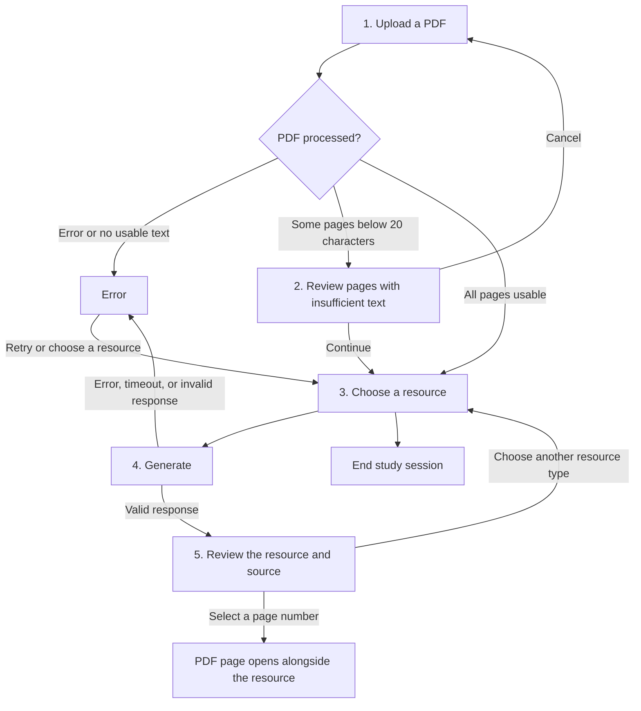

# AI Study Buddy — Initial screen sketch

**Status:** Early UX concepts for review
**Requirements:** PRD FR-1–FR-14
**Purpose:** Define screen order, content, and key states before implementation. The mockups retain the proposed Norwegian interface copy.

**Interactive prototype:** [prototype.html](prototype.html) uses local example data and simulated provider responses.

**UX documents:** [DESIGN.md](DESIGN.md) describes the visual direction, and [EXPERIENCE.md](EXPERIENCE.md) covers behaviour, states, and accessibility. Both documents were drafts for review.

The sketch describes behaviour and hierarchy. The early interactive prototype was a working draft with a calm, modern look. [Four initial concepts](concepts/README.md) explored a broader range of styles. The palette and components in DESIGN.md were still provisional. No direction had been selected at the time of this sketch. Development mocks simulate successful and invalid AI responses so students see either results or Norwegian error messages. Demo mode uses stored examples without an API key. See the later [design decision](designvalg.md).

## User flow



## Screen 1 — Upload a PDF

```text
┌──────────────────────────────────────────────────────────────┐
│ AI Study Buddy                                Studieøkt      │
├──────────────────────────────────────────────────────────────┤
│ Gjør kurs-PDF-en om til øvingsmateriell                      │
│                                                              │
│ ┌──────────────────────────────────────────────────────────┐ │
│ │ Slipp PDF-filen her                                      │ │
│ │ eller                                                    │ │
│ │ [ Velg PDF ]                                             │ │
│ └──────────────────────────────────────────────────────────┘ │
│ Maks. 20 MB og 50 sider.                                     │
│                                                              │
│ [Start demo med eksempel-PDF]                                │
└──────────────────────────────────────────────────────────────┘
```

- File limit errors explain whether the PDF exceeds the size or page limit. Processing stops.
- A loading state is shown during processing. Generation becomes available after the PDF is processed.
- The demo button starts the documented keyless demo with a sample PDF and stored responses.

## Screen 2 — Pages with insufficient extractable text

This screen appears when at least one page has fewer than 20 non-whitespace characters. Page numbers follow the PDF viewer, starting at 1.

```text
┌──────────────────────────────────────────────────────────────┐
│ Vi fant sider med lite lesbar tekst                          │
│                                                              │
│ Side 1 · Side 2 · Side 7 · Side 9                            │
│ Disse sidene tas ikke med hvis du fortsetter.                 │
│                                                              │
│ 46 av 50 sider har nok uttrekkbar tekst.                     │
│                                                              │
│ [Fortsett med 46 sider]                 [Avbryt]              │
└──────────────────────────────────────────────────────────────┘
```

- Before AI generation begins, students see which pages will be excluded.
- **Fortsett** uses pages that meet the extraction threshold. **Avbryt** cancels the operation.
- If every page is usable, the application goes directly to resource selection. If none are usable, it explains the error and lets the student select a different PDF.

## Screen 3 — Choose a resource

```text
┌──────────────────────────────────────────────────────────────┐
│ Studieøkt                               8 KI-forespørsler igjen│
│ Eksempel-PDF.pdf · 46 av 50 sider med i grunnlaget            │
├──────────────────────────────────────────────────────────────┤
│ Hva vil du øve på?                                           │
│                                                              │
│ [ Sammendrag ]          [ Nøkkelbegreper ]                   │
│ [ Flashcards ]          [ Quiz ]                             │
│                                                              │
│ Ressurser du allerede har laget                              │
│ • Ingen ennå                                                 │
│                                                              │
│                                             [Avslutt studieøkt]│
└──────────────────────────────────────────────────────────────┘
```

- Generated resources appear in the list and can be reopened during the same session.
- The counter applies to live mode. Requests count when they start, including failed requests. Demo mode uses stored responses.
- At zero remaining requests, the application explains the limit and blocks further provider calls.
- The study session uses one PDF. To switch PDFs, the student ends the session and starts another.

## Screen 4 — Generation and errors

```text
┌──────────────────────────────────────────────────────────────┐
│ Lager flashcards …                                           │
│                                                              │
│ Vi bruker den opplastede PDF-en. Dette kan ta litt tid.       │
└──────────────────────────────────────────────────────────────┘
```

When the provider fails, times out, or returns an invalid response:

```text
┌──────────────────────────────────────────────────────────────┐
│ Vi kunne ikke lage ressursen                                 │
│ Prøv igjen eller velg en annen ressurs.                      │
│ Ingen delvis ressurs ble lagret.                              │
│                                                              │
│ 7 KI-forespørsler igjen.                                      │
│                                                              │
│ [Prøv igjen]                         [Tilbake til ressurser]  │
└──────────────────────────────────────────────────────────────┘
```

The error message is proposed interface copy. The counter decreases because a request counts when it starts. Earlier resources remain available during the session.

## Screen 5 — Study resource with source and PDF viewer

Wide windows show the resource and PDF viewer side by side. Narrow windows stack them, with the selected page below the resource.

```text
┌───────────────────────────────────────┬──────────────────────┐
│ Sammendrag · Muskelvev                │ PDF                  │
│                                       │                      │
│ • Muskelvev kan trekke seg sammen …   │ Side 12 av 50        │
│   Kilde: «…short source excerpt…»     │                      │
│   [Side 12]  [Ubekreftet hvis feil]   │ [PDF-sidevisning]    │
│                                       │                      │
│ [Sammendrag] [Begreper] [Flashcards]  │ [Quiz]               │
└───────────────────────────────────────┴──────────────────────┘
```

- Each item displays a short source excerpt and page number. Selecting the page number opens the corresponding PDF page while keeping the student in the resource view.
- The resource is marked **Ubekreftet** if the excerpt is missing, absent from the cited page, or cannot be checked.
- **Ubekreftet** means the source reference could not be verified. Even a verified reference gives no guarantee of academic accuracy.
- Summaries and key concepts are grouped by topic. Flashcards show the question first and reveal the answer on request. Quizzes offer three options per question and show answers and explanations after submission. Retries use the same questions in a new order.

## Key empty and blocked states

- **No PDF yet.** Hide resource selection until the PDF has been processed.
- **Unreadable PDF.** Show an explanation in Norwegian and keep resource selection unavailable.
- **PDF exceeds a limit.** Explain which limit was exceeded and stop processing.
- **All pages below the text threshold.** Explain why no pages can be used and block generation.
- **Unverified source.** Keep the resource, show a clear label, and let the student open the cited page when available.
- **Session ended or tab closed.** Start the next session without restoring the PDF or its resources.

## Questions open before visual design

- Whether the initial release should prioritise laptops or give mobile equal weight. The PRD specifies a web application and leaves device priority open.
- Final style, colours, and typography.
- Final copy for errors, loading, and demo mode after a brief user test.

These questions left the low-fidelity flow usable for review. The sketch draws on the PRD and includes draft interface copy.
